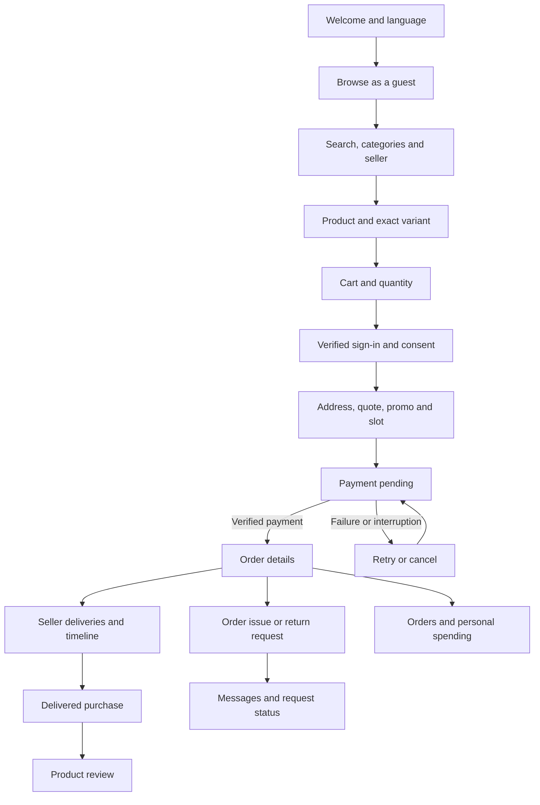

# Customer app map - v2

Source: supplied ALL575 Visual Roadmap & Mapping v2.0, 22 October 2026, especially pages 1, 6, 7, 9, 10 and 11. This maps the current implementation; it is not a claim that every source requirement is complete. The PDF refers to a separate detailed specification that was not supplied here.

## Customer navigation

## Screen and acceptance mapping

| Roadmap requirement                                                                 | Current route / implementation                                          | Coverage and remaining work                                                                                                                                                                               |
| ----------------------------------------------------------------------------------- | ----------------------------------------------------------------------- | --------------------------------------------------------------------------------------------------------------------------------------------------------------------------------------------------------- |
| Three welcome slides on each launch, animated logo, swipe/dot controls                               | `/welcome`                                                              | Implemented; AR/EN and existing French maintained                                                                                                                                                         |
| Guest browsing                                                                      | `/home`, `/categories`, `/search`                                       | Implemented; authentication required at checkout                                                                                                                                                          |
| Category and subcategory                                                            | `/categories/:slug`                                                     | Implemented; demo seed has top-level categories only                                                                                                                                                      |
| Company/seller                                                                      | `/sellers/:slug`                                                        | Seller-specific listing implemented; no combined category + seller filter UI                                                                                                                              |
| Price choices 2-8 SAR and 5.75                                                      | Catalog and backend pricing                                             | **Gap:** current code deliberately fixes all items at 5.75 SAR. Supplied PDF allows multiple prices. Requires a coordinated pricing/catalog/quote change; not silently changed in this aftercare addition |
| Product variants, images, reviews, stock by zone                                    | `/products/:slug`                                                       | Implemented; photo quality and cutout acceptance need visual review                                                                                                                                       |
| OTP/email, mandatory terms and privacy, optional marketing                          | `/sign-in`                                                              | Local OTP log works; contracted SMS/email service still required                                                                                                                                          |
| Biometric unlock                                                                    | Native sign-in                                                          | **Gap:** not implemented                                                                                                                                                                                  |
| Saudi address fields, saved address, coordinates                                    | `/account/addresses`, `/new`, `/:addressId`                             | Implemented; map currently uses Leaflet/OpenStreetMap, **not the Google Maps integration requested in the PDF**                                                                                           |
| Cart, server quote, promo, included VAT                                             | `/cart`, `/checkout`                                                    | Implemented with integer halalas; no per-product exclusive-price entry mode                                                                                                                               |
| Delivery slot and address revalidation                                              | `/checkout`                                                             | Home delivery implemented; **branch pickup not implemented**                                                                                                                                              |
| mada, cards, Apple Pay                                                              | `/checkout/payment/:orderId`                                            | Local simulation only; no real charge or wallet certification                                                                                                                                             |
| Verified payment, safe retry, reservation expiry                                    | Payment screen + API services                                           | Implemented with fake signed gateway callbacks for testing                                                                                                                                                |
| Multi-seller deliveries, ETA, order timeline                                        | `/orders/:orderId`                                                      | Implemented; seller/courier actions simulated using CLI                                                                                                                                                   |
| Live courier map, contact and operational dispatch                                  | Order tracking                                                          | **Gap:** not implemented; never show an invented live location                                                                                                                                            |
| Dedicated delivery code                                                             | Order details while on the way                                          | Implemented display and backend verification service; local `orders:advance` is a simulation, not proof of courier handover                                                                               |
| Product reviews and edits                                                           | Delivered order items                                                   | Implemented; separate order/seller/courier ratings, reporting/appeals and moderation workflow remain gaps                                                                                                 |
| Customer cancellation before preparation                                            | Order details                                                           | Implemented; financial status stays distinct from order status                                                                                                                                            |
| Order-linked support case and replies                                               | `/orders/:orderId/help`, `/account/support`, `/account/support/:caseId` | **Added:** scoped list, request, conversation and status; local/testing support reply CLI                                                                                                                 |
| Partial item return request                                                         | Same help screen, select Return an item                                 | **Added:** delivered line/variant selection, quantity limits, duplicate-request protection; request is pending review                                                                                     |
| Return approval policy, evidence uploads, collection, inspection and partial refund | Operations + payments                                                   | **Gap:** no production support console, attachment uploads, automatic eligibility window, return logistics or return-triggered refunds. Written evidence/details can be supplied in a message             |
| Pending/success/failure refund display                                              | Order details                                                           | Existing cancellation refund display; a case resolution never marks money refunded                                                                                                                        |
| Invoices and credit-note documents                                                  | Order details                                                           | **Gap:** PDF invoice and downloadable credit note are absent; refund metadata can contain credit-note number                                                                                              |
| Personal spending and history                                                       | `/account/spending`                                                     | Date ranges and CSV implemented; XLSX/PDF, category/seller/status filters absent                                                                                                                          |
| Marketing choice, profile and sessions                                              | `/account`, `/account/profile`, `/account/sessions`                     | Implemented; channel-specific notification controls and contact change reverification absent                                                                                                              |
| Data access and account closure                                                     | Account support                                                         | **Gap:** formal account-level request/retention workflow absent; current cases require an order                                                                                                           |

## New aftercare flow

1. Open **Account > Orders > an order > Get help or request a return**.
2. For a delivery/payment/order question choose **Order issue**. Enter a subject and description.
3. For a return choose **Return an item**, a delivered item/variant, quantity, reason and description.
4. Submit. The server assigns a reference and `submitted` status. Retrying the same request after a lost response reuses its key.
5. Follow the conversation under **Account > Support and returns**. Add a message while the request is open.
6. Support can review, resolve or reject on the development server with `care:reply`. A production support console remains to be built.
7. A return quantity already requested is unavailable to another request unless the earlier request is rejected. Resolving a case does not restore stock or create a refund.
8. Only payment provider completion can confirm refund success. Check the order's separate refund record.

## Contract and scope

Both repositories use `v2`. Backend owns OpenAPI; frontend pins its exact backend commit. No production API keys, real payments, deployment or Play Store release is configured by this change. See [CUSTOMER_TEST_GUIDE.md](CUSTOMER_TEST_GUIDE.md) for setup and executable scenarios.
